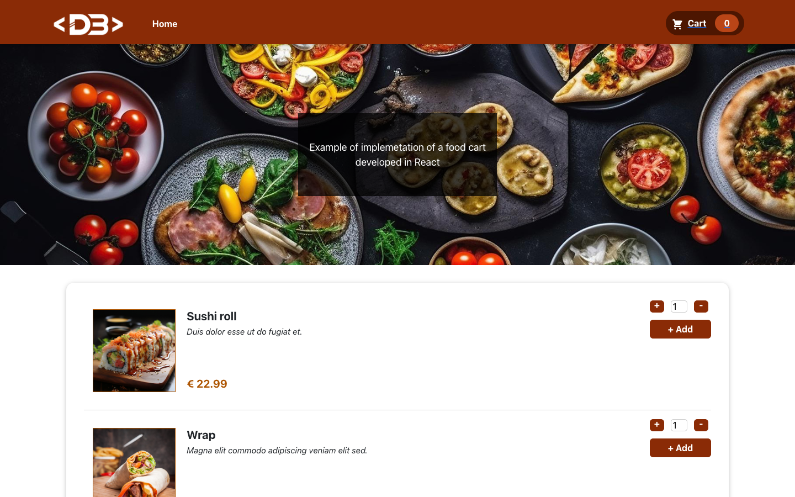

# React Food Cart

An example of a food ordering app built with React: browse the menu, add dishes to the cart and complete a multi-step checkout. State is managed with React Context and `useReducer`.

**Live demo:** <https://react-food-cart.davidebalice.dev/>



## Features

- Menu of dishes with image, description and price
- Choose the quantity (1–10) and add dishes to the cart, with input validation
- Cart badge in the header with the number of items
- Cart page: increase/decrease quantity, remove items, live total
- Multi-step checkout with step indicator: login, shipping data, order summary and confirmation
- Demo login (email `mario@rossi.it`, password `12345678`)
- Responsive layout

## Tech stack

- [React 18](https://react.dev/) (Create React App)
- [React Router 6](https://reactrouter.com/)
- [React Bootstrap](https://react-bootstrap.github.io/) / [Bootstrap 5](https://getbootstrap.com/)
- [React Icons](https://react-icons.github.io/react-icons/)
- React Context + `useReducer`, CSS Modules

## Getting started

### Requirements

- Node.js 18 or later
- npm

### Installation

```bash
git clone https://github.com/davidebalice/react-food-cart.git
cd react-food-cart
npm install
```

### Available scripts

| Command         | Description                             |
| --------------- | --------------------------------------- |
| `npm start`     | Start the development server            |
| `npm run build` | Create a production build in `build/`   |
| `npm test`      | Run the tests                           |

## Project structure

```
src/
├── components/   # Food list, cart, checkout steps, layout and UI components
├── context/      # Cart and auth contexts, reducer
├── data/         # Menu items
├── pages/        # Home, Cart, Login, Shipping, Summary, Confirm, Logout
├── router/       # Application routes
└── utils/        # Number formatting
```

## Author

**Davide Balice** – [davidebalice.dev](https://www.davidebalice.dev)
